[](https://pub.dev/packages/hijri_picker)


# Selector de Fecha Hijri

Selector de fechas Hijri (Umm al-Qura / calendario islámico) para Flutter.

## Descripción general

Desde la v5.0.0, este paquete es un adaptador ligero que permite que el selector de fechas integrado de Material 3 de Flutter renderice fechas Hijri. Implementa la API [`CalendarDelegate`](https://api.flutter.dev/flutter/material/CalendarDelegate-class.html) introducida en Flutter 3.32, por lo que obtienes `showDatePicker`, `CalendarDatePicker`, `DatePickerDialog`, `InputDatePickerFormField` y `YearPicker` de Flutter de forma nativa — con nombres de meses Hijri, desplazamientos de días de la semana Hijri, longitudes de meses Hijri y personalización completa de temas mediante `DatePickerThemeData`.

## Requisitos

- Flutter `>=3.32.0`
- Dart `^3.8.0`
- `hijri ^3.0.1` (dependencia en tiempo de ejecución)

## Capturas de pantalla

### Tema claro — semilla `Colors.amber`

<table>
<tr>
<td align="center" width="25%">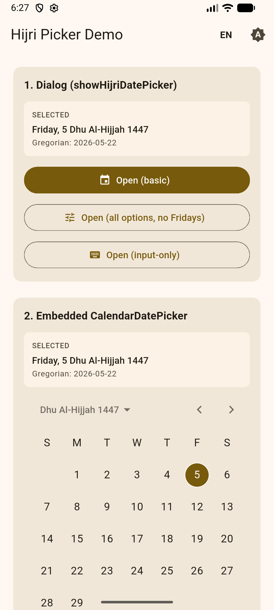<br/><sub><b>1.</b> Inicio — parte superior: lanzadores de <code>showHijriDatePicker</code> + <code>CalendarDatePicker</code> integrado mostrando Dhu Al-Hijjah 1447, viernes 5 seleccionado.</sub></td>
<td align="center" width="25%">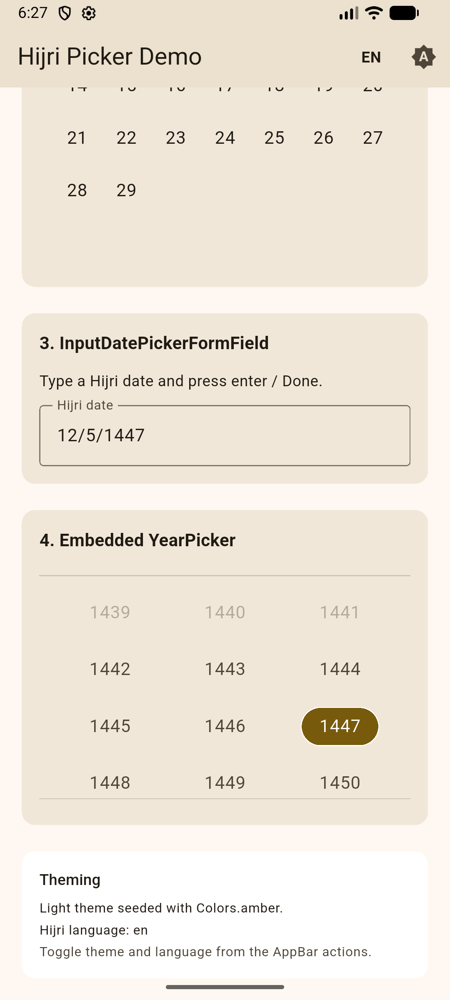<br/><sub><b>2.</b> Inicio — parte inferior: <code>InputDatePickerFormField</code>, el <code>YearPicker</code> de 3 columnas integrado (1447 seleccionado) y la tarjeta de leyenda de temas.</sub></td>
<td align="center" width="25%">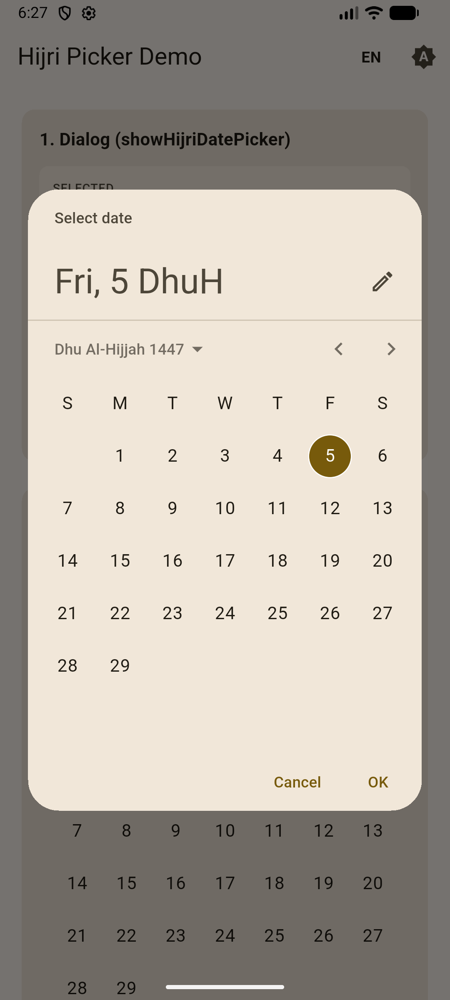<br/><sub><b>3.</b> <code>showHijriDatePicker</code> — diálogo básico. El encabezado dice "Fri, 5 DhuH"; icono de lápiz para alternar el modo M3 en la esquina.</sub></td>
<td align="center" width="25%">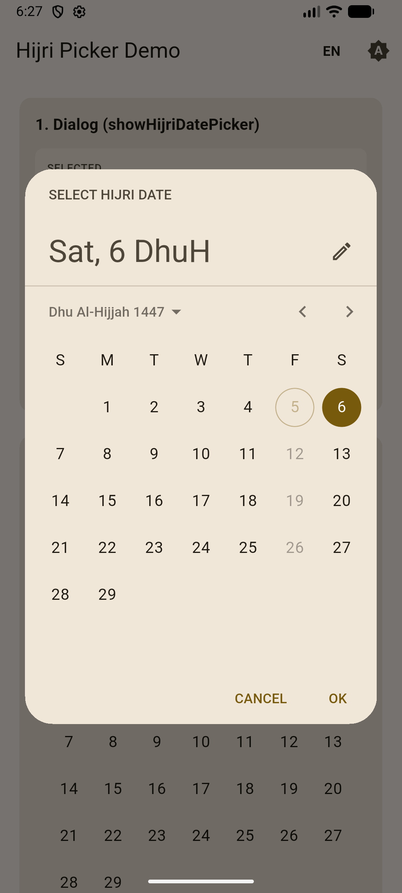<br/><sub><b>4.</b> Opciones completas: <code>helpText: "SELECCIONAR FECHA HIJRI"</code> personalizado, <code>cancelText</code>/<code>confirmText</code> en mayúsculas y un <code>selectableDayPredicate</code> que desactiva los viernes (nota el viernes 5 desactivado y circulado).</sub></td>
</tr>
<tr>
<td align="center" colspan="2">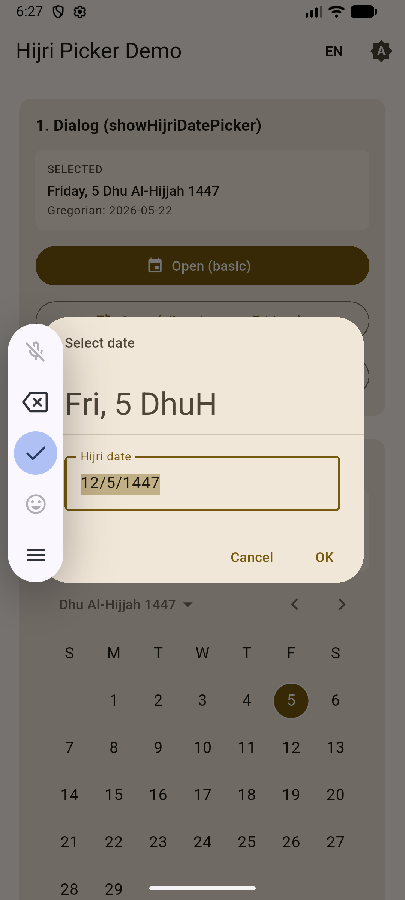<br/><sub><b>5.</b> Modo de entrada (el icono del lápiz cambia a entrada de texto). Escribe <code>12/5/1447</code> en el formato compacto de la localización — aceptado por <code>HijriCalendarDelegate.parseCompactDate</code>.</sub></td>
</tr>
</table>

### Tema oscuro — semilla `Colors.blue`

<table>
<tr>
<td align="center" width="25%">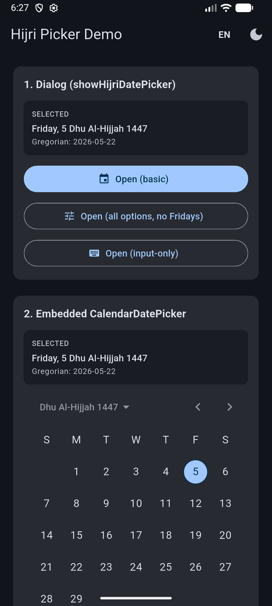<br/><sub><b>6.</b> Mismo inicio en modo oscuro — Material 3 adopta la semilla azul para los colores primarios/de selección mediante <code>ColorScheme.fromSeed</code>.</sub></td>
<td align="center" width="25%"><br/><sub><b>7.</b> Inicio oscuro, desplazado: campo de entrada, cuadrícula de años (1447 resaltado en azul) y la leyenda de temas oscuros.</sub></td>
<td align="center" width="25%">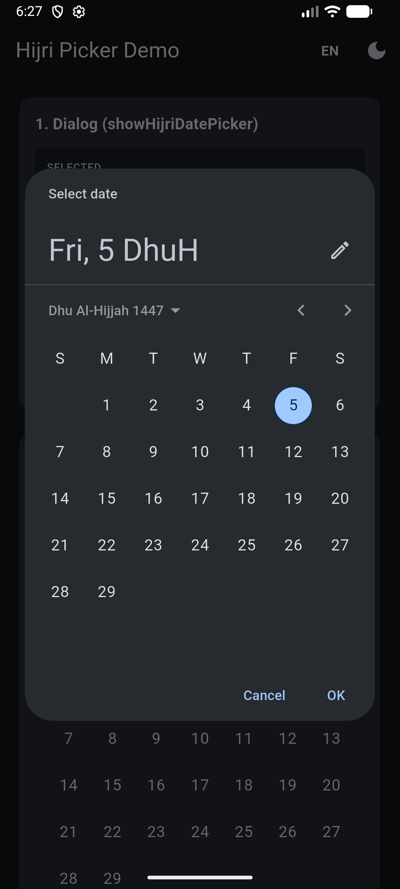<br/><sub><b>8.</b> Diálogo básico de <code>showHijriDatePicker</code> en modo oscuro — nombre del mes Hijri en el encabezado, chip de selección azul en el día 5.</sub></td>
<td align="center" width="25%">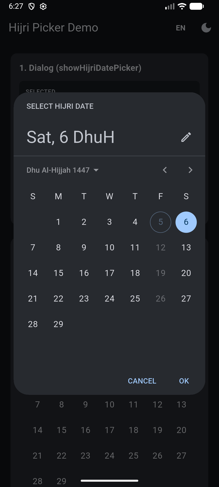<br/><sub><b>9.</b> Diálogo de opciones completas en modo oscuro — viernes desactivados por predicado, día 6 (sábado) seleccionado.</sub></td>
</tr>
<tr>
<td align="center" colspan="2">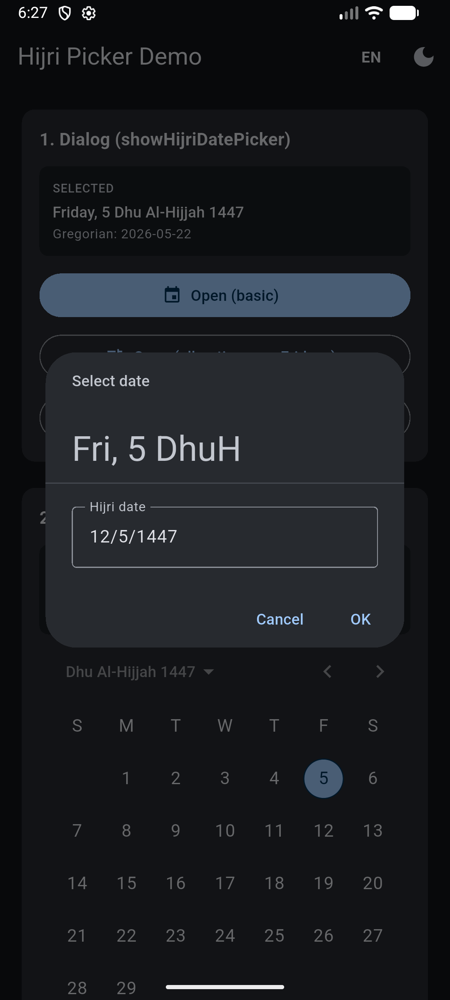<br/><sub><b>10.</b> <code>DatePickerEntryMode.inputOnly</code> — abre directamente en un campo de texto compacto, sin calendario.</sub></td>
<td align="center" colspan="2">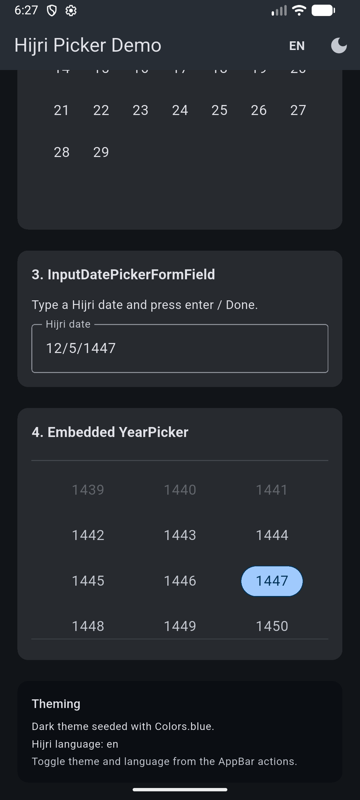<br/><sub><b>11.</b> Inicio oscuro desplazado — cuadrícula de años Hijri 1439–1450 con 1447 seleccionado (años fuera de rango 1439–1441 atenuados).</sub></td>
</tr>
</table>

### Localización árabe (RTL)

<table>
<tr>
<td align="center" width="33%">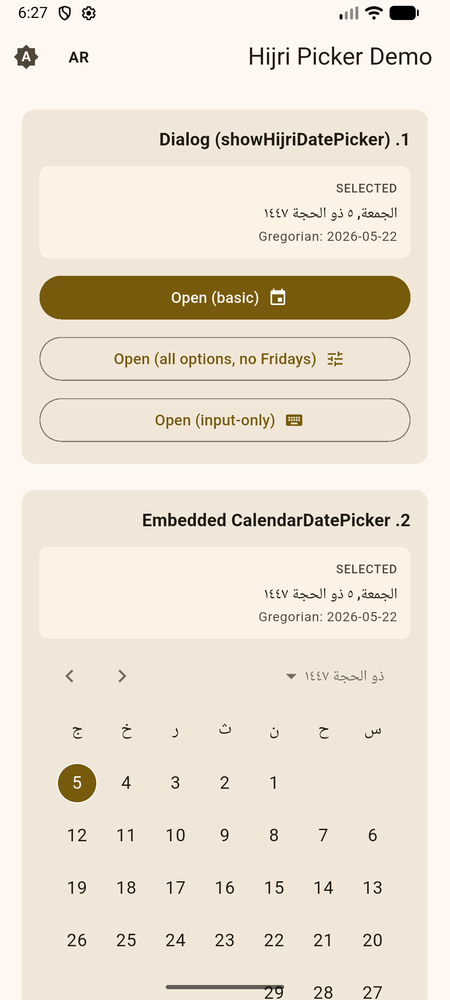<br/><sub><b>12.</b> Localización cambiada a <code>ar_SA</code> mediante el interruptor de la AppBar. Diseño invertido a RTL; el calendario utiliza abreviaturas de días de la semana en árabe y dígitos árabes orientales.</sub></td>
<td align="center" width="33%">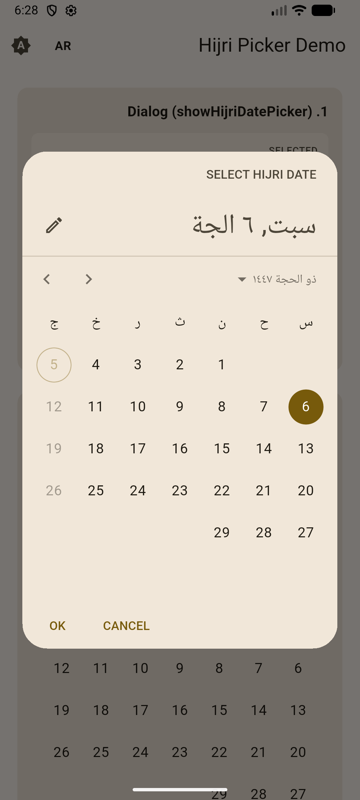<br/><sub><b>13.</b> Diálogo de <code>showHijriDatePicker</code> en árabe. El <code>cancelText</code>/<code>confirmText</code> sigue siendo la sobrescritura en inglés que pasamos (demostrando que tienen prioridad sobre <code>MaterialLocalizations</code>).</sub></td>
<td align="center" width="33%">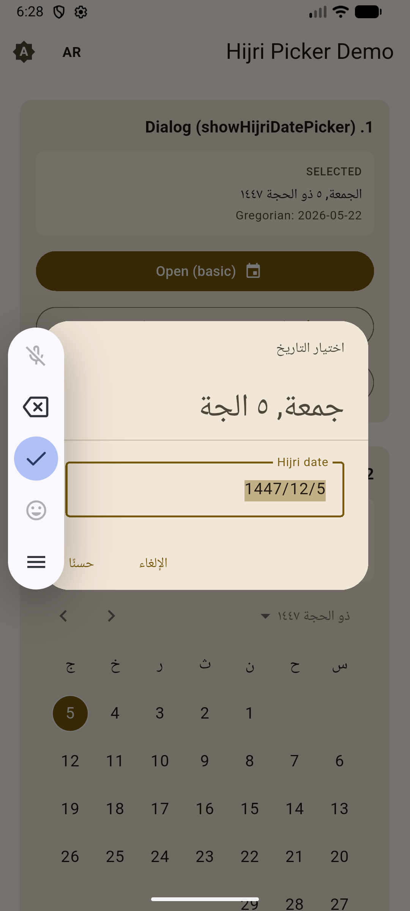<br/><sub><b>14.</b> Modo de entrada en árabe — campo de fecha compacto escrito como <code>1447/12/5</code>.</sub></td>
</tr>
<tr>
<td align="center" width="50%">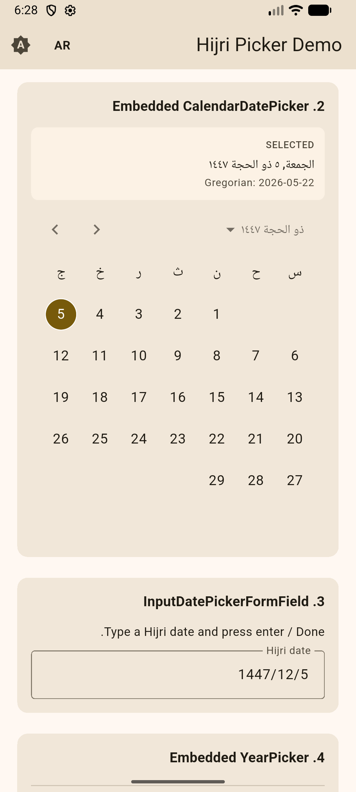<br/><sub><b>15.</b> <code>CalendarDatePicker</code> + <code>InputDatePickerFormField</code> integrado en árabe — mismos widgets, diseño RTL, nombre del mes en árabe.</sub></td>
<td align="center" width="50%">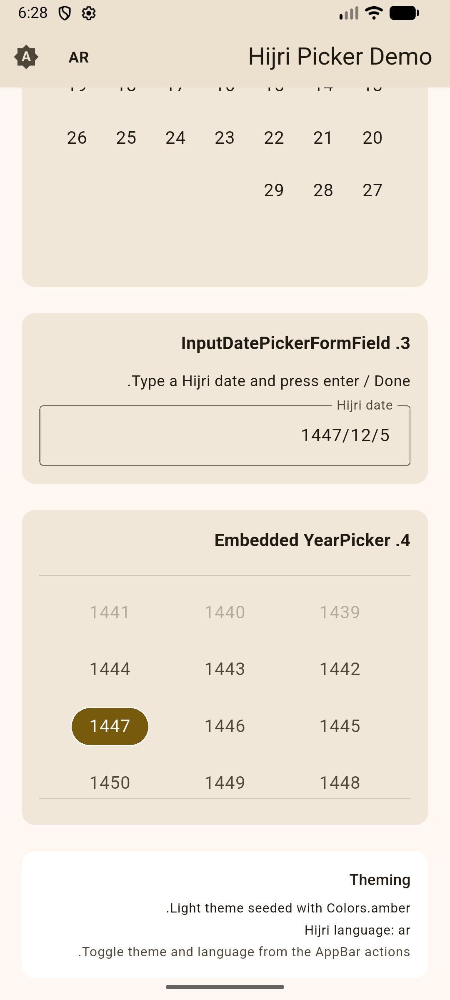<br/><sub><b>16.</b> <code>YearPicker</code> integrado en árabe — cuadrícula de años M3 de 3 columnas (1441–1450), 1447 seleccionado.</sub></td>
</tr>
</table>

## Inicio rápido

Registra los delegados de localización estándar de Material/Widgets:

```dart
MaterialApp(
  localizationsDelegates: const [
    GlobalMaterialLocalizations.delegate,
    GlobalWidgetsLocalizations.delegate,
    GlobalCupertinoLocalizations.delegate,
  ],
  supportedLocales: const [
    Locale('en', 'US'),
    Locale('ar', 'SA'),
  ],
  // ...
);
```

### Opción 1 — `showHijriDatePicker` (comodín tipado)

```dart
final HijriDateTime now = HijriDateTime.now();
final HijriDateTime? picked = await showHijriDatePicker(
  context: context,
  initialDate: now,
  firstDate: HijriDateTime(now.year - 5, 1, 1),
  lastDate: HijriDateTime(now.year + 5, 12, 29),
  hijriLanguage: 'ar', // 'en', 'ar', 'tr', or any locale added via HijriCalendar.addLocale
);
```

### Opción 2 — `showDatePicker` de Flutter con `HijriCalendarDelegate`

```dart
final HijriDateTime? picked = await showDatePicker(
  context: context,
  initialDate: HijriDateTime.now(),
  firstDate: HijriDateTime(1440, 1, 1),
  lastDate: HijriDateTime(1455, 12, 29),
  calendarDelegate: const HijriCalendarDelegate(language: 'ar'),
) as HijriDateTime?;
```

### Opción 3 — Widgets integrados

El mismo delegado se conecta también a los widgets integrables:

```dart
CalendarDatePicker(
  initialDate: HijriDateTime.now(),
  firstDate: HijriDateTime(1440, 1, 1),
  lastDate: HijriDateTime(1455, 12, 29),
  onDateChanged: (DateTime d) => setState(() => selected = d as HijriDateTime),
  calendarDelegate: const HijriCalendarDelegate(),
);

InputDatePickerFormField(
  initialDate: HijriDateTime.now(),
  firstDate: HijriDateTime(1440, 1, 1),
  lastDate: HijriDateTime(1455, 12, 29),
  onDateSubmitted: (DateTime d) { /* d is a HijriDateTime */ },
  calendarDelegate: const HijriCalendarDelegate(),
);

YearPicker(
  firstDate: HijriDateTime(1440, 1, 1),
  lastDate: HijriDateTime(1455, 12, 29),
  selectedDate: HijriDateTime.now(),
  currentDate: HijriDateTime.now(), // required workaround — see note below
  onChanged: (DateTime d) { /* ... */ },
  calendarDelegate: const HijriCalendarDelegate(),
);
```

> **Nota sobre `YearPicker`:** El constructor de `YearPicker` de Flutter establece
> `currentDate` por defecto en `DateTime.now()` (gregoriano simple) en lugar de
> `calendarDelegate.now()`, lo cual provoca un bloqueo con cualquier delegado no gregoriano.
> Solución: pasa siempre `currentDate: HijriDateTime.now()` explícitamente.
> Los demás puntos de entrada (`CalendarDatePicker`, `DatePickerDialog`,
> `showDatePicker`) manejan esto correctamente.

## Temas

Toda la personalización de temas fluye a través de la
[`DatePickerThemeData`](https://api.flutter.dev/flutter/material/DatePickerThemeData-class.html) de Flutter:

```dart
MaterialApp(
  theme: ThemeData(
    useMaterial3: true,
    colorScheme: ColorScheme.fromSeed(
      seedColor: Colors.amber,
      brightness: Brightness.light,
    ),
    datePickerTheme: const DatePickerThemeData(
      backgroundColor: Color(0xFFFFF8E1),
      headerBackgroundColor: Colors.amber,
      headerForegroundColor: Colors.black87,
    ),
  ),
);
```

## Manejo de resultados

`HijriDateTime` extiende `DateTime`; sus `.year`/`.month`/`.day` son los
componentes Hijri. Convierte mediante:

```dart
final HijriDateTime d = HijriDateTime.now();
final HijriCalendar h = d.toHijriCalendar();   // hijri package's calendar object
final DateTime gregorian = d.toGregorian();    // equivalent Gregorian date

// Construct from sources:
HijriDateTime.fromHijriCalendar(someHijriCalendar);
HijriDateTime.fromGregorian(DateTime(2026, 5, 22));
```

## Migración desde la versión 4.x

La v5.0.0 es una reescritura con cambios incompatibles. Los widgets personalizados han sido eliminados.

| 4.x | 5.x |
| --- | --- |
| `showHijriDatePicker(initialDate: HijriCalendar..)` | `showHijriDatePicker(initialDate: HijriDateTime(..))` |
| Widget `HijriMonthPicker` | Usa el `CalendarDatePicker` de Flutter con `calendarDelegate: HijriCalendarDelegate()` |
| Widgets `HijriDayPicker` / `HijriYearPicker` | Usa los integrados de Flutter (interno `_DayPicker`, público `YearPicker`) |
| `HijriCalendarBuilders` (constructores personalizados de día/día de la semana) | Eliminados — personaliza mediante `DatePickerThemeData` |
| Tipo de retorno `HijriCalendar?` | Tipo de retorno `HijriDateTime?` (llama a `.toHijriCalendar()` o `.toGregorian()` para interoperabilidad) |

## Licencia

MIT — ver [LICENSE](LICENSE).

## Autor

Ahmed Aljoaid — [@ahmedoid](https://github.com/ahmedoid)
