[](https://pub.dev/packages/hijri_picker)


# Hijri Date Picker

Hijri (Umm al-Qura / Islamic calendar) date picker for Flutter.

## Overview

Since v5.0.0, this package is a thin adapter that lets Flutter's built-in
Material 3 date picker render Hijri dates. It implements the
[`CalendarDelegate`](https://api.flutter.dev/flutter/material/CalendarDelegate-class.html)
API introduced in Flutter 3.32, so you get Flutter's `showDatePicker`,
`CalendarDatePicker`, `DatePickerDialog`, `InputDatePickerFormField`, and
`YearPicker` for free — with Hijri month names, Hijri weekday offsets,
Hijri month lengths, and full theming via `DatePickerThemeData`.

## Requirements

- Flutter `>=3.32.0`
- Dart `^3.8.0`
- `hijri ^3.0.1` (runtime dependency)

## Screenshots

### Light theme — `Colors.amber` seed

<table>
<tr>
<td align="center" width="25%">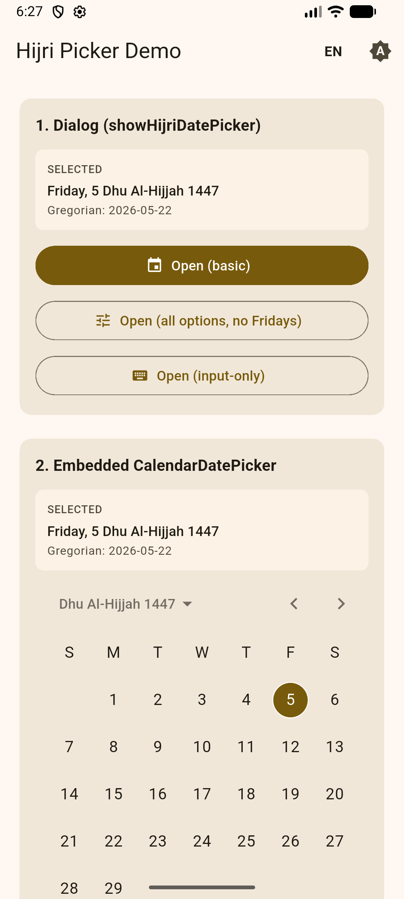<br/><sub><b>1.</b> Home — top: <code>showHijriDatePicker</code> launchers + embedded <code>CalendarDatePicker</code> showing Dhu Al-Hijjah 1447, Friday 5 selected.</sub></td>
<td align="center" width="25%">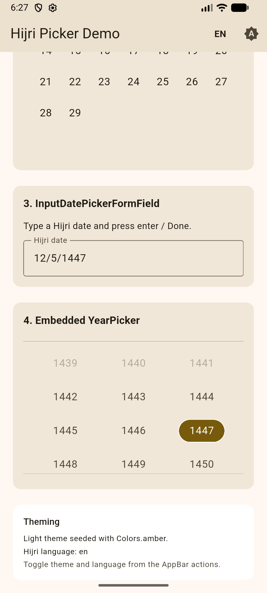<br/><sub><b>2.</b> Home — bottom: <code>InputDatePickerFormField</code>, the embedded 3-column <code>YearPicker</code> (1447 selected), and the theming legend card.</sub></td>
<td align="center" width="25%">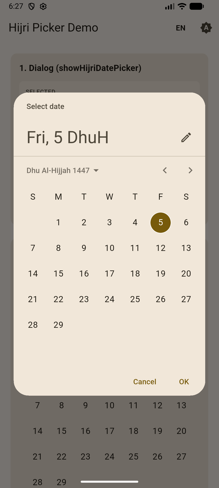<br/><sub><b>3.</b> <code>showHijriDatePicker</code> — basic dialog. Header reads "Fri, 5 DhuH"; M3 mode-toggle pencil icon in the corner.</sub></td>
<td align="center" width="25%">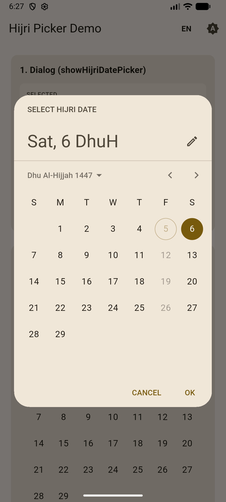<br/><sub><b>4.</b> Full options: custom <code>helpText: "SELECT HIJRI DATE"</code>, uppercase <code>cancelText</code>/<code>confirmText</code>, and a <code>selectableDayPredicate</code> that disables Fridays (note the circled-disabled Friday 5).</sub></td>
</tr>
<tr>
<td align="center" colspan="2">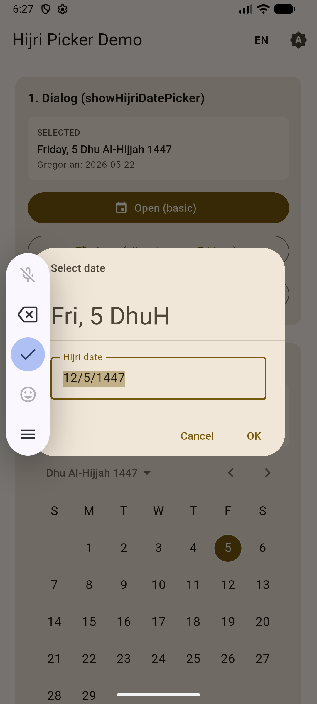<br/><sub><b>5.</b> Input mode (the pencil icon toggles to text-input). Typing <code>12/5/1447</code> in the locale's compact format — accepted by <code>HijriCalendarDelegate.parseCompactDate</code>.</sub></td>
</tr>
</table>

### Dark theme — `Colors.blue` seed

<table>
<tr>
<td align="center" width="25%">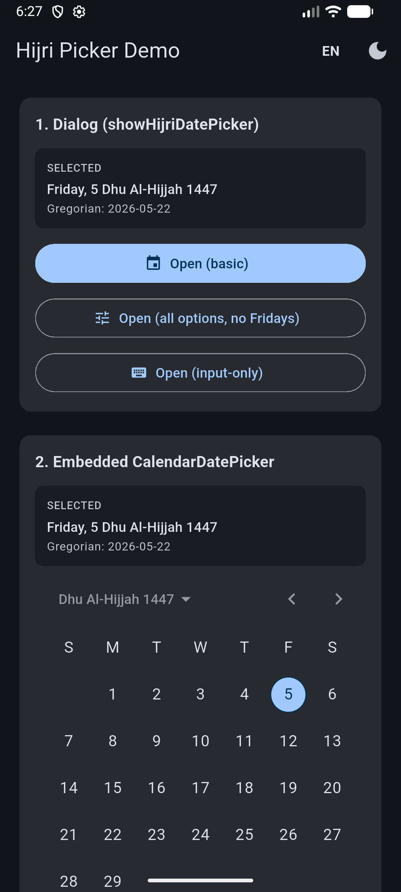<br/><sub><b>6.</b> Same home in dark mode — Material 3 picks up the blue seed for primary/selection colors via <code>ColorScheme.fromSeed</code>.</sub></td>
<td align="center" width="25%"><br/><sub><b>7.</b> Dark home, scrolled: input field, year grid (1447 highlighted in blue), and the dark theming legend.</sub></td>
<td align="center" width="25%">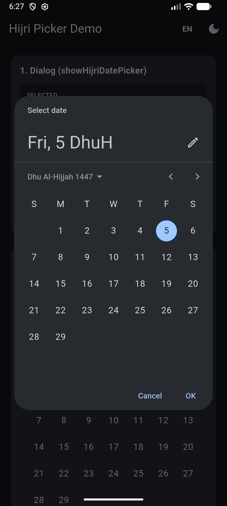<br/><sub><b>8.</b> Basic <code>showHijriDatePicker</code> dialog in dark mode — Hijri month name in the header, blue selection chip on day 5.</sub></td>
<td align="center" width="25%">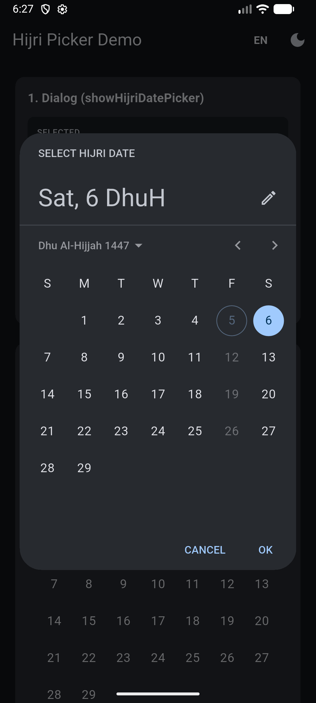<br/><sub><b>9.</b> Full-options dialog in dark mode — Fridays disabled by predicate, day 6 (Saturday) selected.</sub></td>
</tr>
<tr>
<td align="center" colspan="2">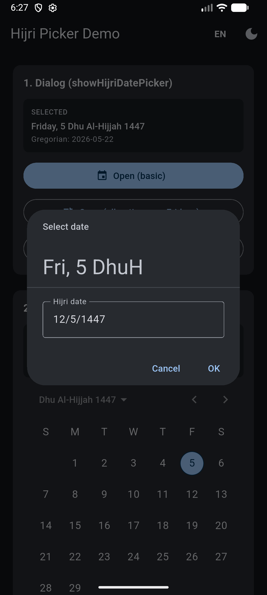<br/><sub><b>10.</b> <code>DatePickerEntryMode.inputOnly</code> — opens straight into a compact text field, no calendar.</sub></td>
<td align="center" colspan="2">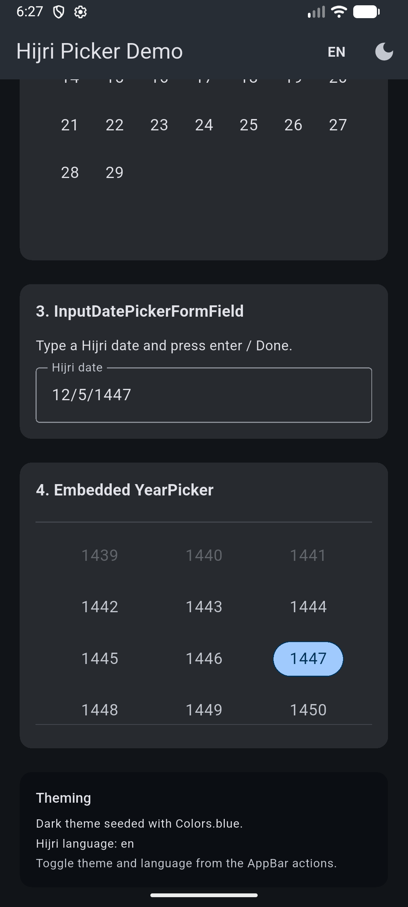<br/><sub><b>11.</b> Dark home scrolled — Hijri year grid 1439–1450 with 1447 selected (out-of-range years 1439–1441 dimmed).</sub></td>
</tr>
</table>

### Arabic locale (RTL)

<table>
<tr>
<td align="center" width="33%">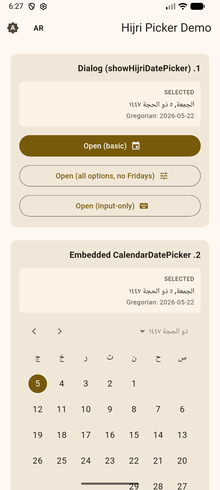<br/><sub><b>12.</b> Locale switched to <code>ar_SA</code> via the AppBar toggle. Layout flipped to RTL; calendar uses Arabic weekday abbreviations and Eastern-Arabic digits.</sub></td>
<td align="center" width="33%">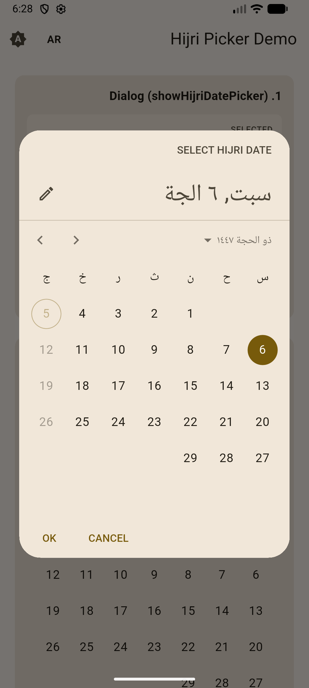<br/><sub><b>13.</b> <code>showHijriDatePicker</code> dialog in Arabic. The <code>cancelText</code>/<code>confirmText</code> are still the English overrides we passed (demonstrating they take precedence over <code>MaterialLocalizations</code>).</sub></td>
<td align="center" width="33%">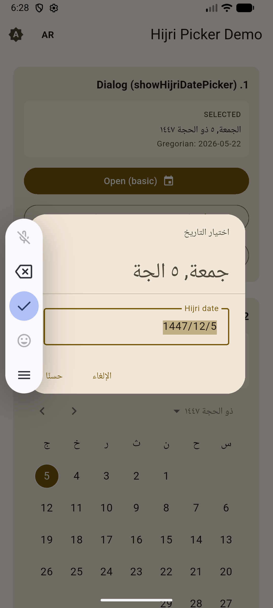<br/><sub><b>14.</b> Arabic input mode — compact-date field typed as <code>1447/12/5</code>.</sub></td>
</tr>
<tr>
<td align="center" width="50%">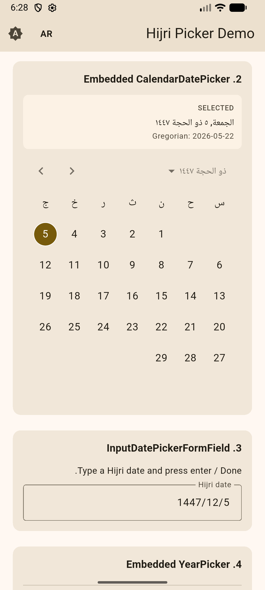<br/><sub><b>15.</b> Embedded <code>CalendarDatePicker</code> + <code>InputDatePickerFormField</code> in Arabic — same widgets, RTL layout, Arabic month name.</sub></td>
<td align="center" width="50%">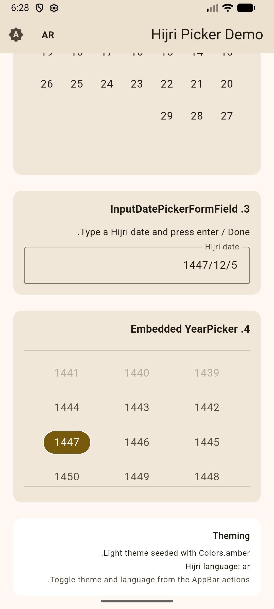<br/><sub><b>16.</b> Embedded <code>YearPicker</code> in Arabic — 3-column M3 year grid (1441–1450), 1447 selected.</sub></td>
</tr>
</table>

## Quick start

Register the standard Material/Widgets localization delegates:

```dart
MaterialApp(
  localizationsDelegates: const [
    GlobalMaterialLocalizations.delegate,
    GlobalWidgetsLocalizations.delegate,
    GlobalCupertinoLocalizations.delegate,
  ],
  supportedLocales: const [
    Locale('en', 'US'),
    Locale('ar', 'SA'),
  ],
  // ...
);
```

### Option 1 — `showHijriDatePicker` (typed convenience)

```dart
final HijriDateTime now = HijriDateTime.now();
final HijriDateTime? picked = await showHijriDatePicker(
  context: context,
  initialDate: now,
  firstDate: HijriDateTime(now.year - 5, 1, 1),
  lastDate: HijriDateTime(now.year + 5, 12, 29),
  hijriLanguage: 'ar', // 'en', 'ar', 'tr', or any locale added via HijriCalendar.addLocale
);
```

### Option 2 — Flutter's `showDatePicker` with `HijriCalendarDelegate`

```dart
final HijriDateTime? picked = await showDatePicker(
  context: context,
  initialDate: HijriDateTime.now(),
  firstDate: HijriDateTime(1440, 1, 1),
  lastDate: HijriDateTime(1455, 12, 29),
  calendarDelegate: const HijriCalendarDelegate(language: 'ar'),
) as HijriDateTime?;
```

### Option 3 — Embedded widgets

The same delegate plugs into the embeddable widgets too:

```dart
CalendarDatePicker(
  initialDate: HijriDateTime.now(),
  firstDate: HijriDateTime(1440, 1, 1),
  lastDate: HijriDateTime(1455, 12, 29),
  onDateChanged: (DateTime d) => setState(() => selected = d as HijriDateTime),
  calendarDelegate: const HijriCalendarDelegate(),
);

InputDatePickerFormField(
  initialDate: HijriDateTime.now(),
  firstDate: HijriDateTime(1440, 1, 1),
  lastDate: HijriDateTime(1455, 12, 29),
  onDateSubmitted: (DateTime d) { /* d is a HijriDateTime */ },
  calendarDelegate: const HijriCalendarDelegate(),
);

YearPicker(
  firstDate: HijriDateTime(1440, 1, 1),
  lastDate: HijriDateTime(1455, 12, 29),
  selectedDate: HijriDateTime.now(),
  currentDate: HijriDateTime.now(), // required workaround — see note below
  onChanged: (DateTime d) { /* ... */ },
  calendarDelegate: const HijriCalendarDelegate(),
);
```

> **Note on `YearPicker`:** Flutter's `YearPicker` constructor defaults
> `currentDate` to `DateTime.now()` (plain Gregorian) rather than
> `calendarDelegate.now()`, which crashes with any non-Gregorian delegate.
> Workaround: always pass `currentDate: HijriDateTime.now()` explicitly.
> The other entry points (`CalendarDatePicker`, `DatePickerDialog`,
> `showDatePicker`) handle this correctly.

## Theming

All theming flows through Flutter's
[`DatePickerThemeData`](https://api.flutter.dev/flutter/material/DatePickerThemeData-class.html):

```dart
MaterialApp(
  theme: ThemeData(
    useMaterial3: true,
    colorScheme: ColorScheme.fromSeed(
      seedColor: Colors.amber,
      brightness: Brightness.light,
    ),
    datePickerTheme: const DatePickerThemeData(
      backgroundColor: Color(0xFFFFF8E1),
      headerBackgroundColor: Colors.amber,
      headerForegroundColor: Colors.black87,
    ),
  ),
);
```

## Working with results

`HijriDateTime` extends `DateTime`; its `.year`/`.month`/`.day` are the Hijri
components. Convert via:

```dart
final HijriDateTime d = HijriDateTime.now();
final HijriCalendar h = d.toHijriCalendar();   // hijri package's calendar object
final DateTime gregorian = d.toGregorian();    // equivalent Gregorian date

// Construct from sources:
HijriDateTime.fromHijriCalendar(someHijriCalendar);
HijriDateTime.fromGregorian(DateTime(2026, 5, 22));
```

## Migration from 4.x

v5.0.0 is a breaking rewrite. The custom widgets have been removed.

| 4.x | 5.x |
| --- | --- |
| `showHijriDatePicker(initialDate: HijriCalendar..)` | `showHijriDatePicker(initialDate: HijriDateTime(..))` |
| `HijriMonthPicker` widget | Use Flutter's `CalendarDatePicker` with `calendarDelegate: HijriCalendarDelegate()` |
| `HijriDayPicker` / `HijriYearPicker` widgets | Use Flutter's built-ins (internal `_DayPicker`, public `YearPicker`) |
| `HijriCalendarBuilders` (custom day/weekday builders) | Removed — customize via `DatePickerThemeData` |
| Return type `HijriCalendar?` | Return type `HijriDateTime?` (call `.toHijriCalendar()` or `.toGregorian()` to interop) |

## License

MIT — see [LICENSE](LICENSE).

## Author

Ahmed Aljoaid — [@ahmedoid](https://github.com/ahmedoid)
